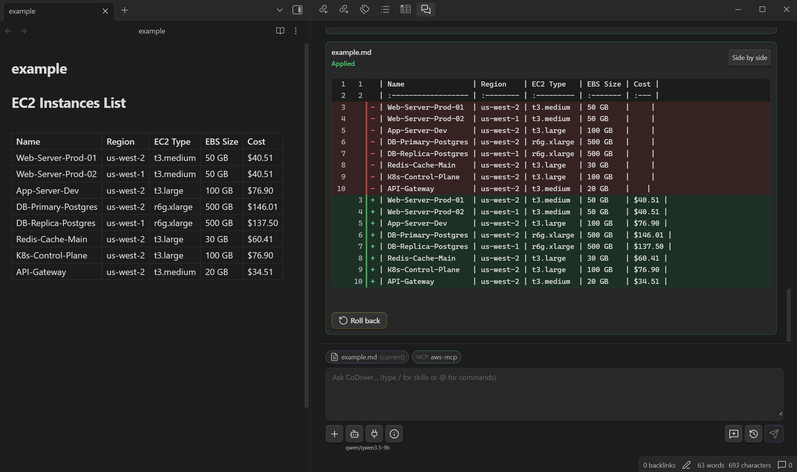

# CoDriver

Chat with your Obsidian vault without leaving Obsidian.

CoDriver puts your preferred language models in the right sidebar. Create, improve, and organize notes without giving up control over changes.

## What you can do

- Create notes, append content, update text and properties, move files, and send notes to trash.
- Review note patches as a unified diff or side-by-side comparison, then accept, reject, or roll back an applied patch.
- Create and edit Canvas diagrams through reviewed text changes with mandatory JSON Canvas validation.
- Connect OpenAI-compatible providers, Gemini, or Anthropic and switch models from the chat composer.
- Connect external MCP tools and add skills to extend the assistant with reusable instructions and access to your workflows.
- See every vault tool call and control automatic execution per tool.
- Works on desktop and mobile; desktop-only features are marked below.

## Add your first provider

1. Open **Settings -> CoDriver Settings -> Providers**.
2. Click **Add model** under **LLM providers**.
3. Choose the **Provider type**. For OpenAI-compatible services, search **Preset** by provider or brand name. Selecting a preset fills its endpoint immediately and makes **Endpoint** read-only. Choose **Custom** to enter an endpoint; it starts empty. For Alibaba Cloud, choose Custom and enter your regional workspace base URL from its console.
4. Enter the **API key** directly. The field starts masked; use the eye button to show or hide it. Keys stay in Obsidian secret storage. Model loading uses the current input without saving it.
5. Click **Load models** for OpenAI-compatible services, or **Test connection** for Gemini and Anthropic, to load available models.
6. Choose the **Default model**, then click **Save**. The optional **Model ID** field is shown for Custom, Together AI, Fireworks AI, DeepInfra, Z.ai, NVIDIA and Alibaba presets, whose catalog support is unknown or differs from the standard model-list API. It also appears after a failed or empty **Load models** result. Endpoint edits do not affect its visibility. Manual entry does not confirm chat compatibility. Saved profiles reopen under Custom with their values preserved and an editable endpoint.

Presets include OpenAI, OpenRouter, DeepSeek, Groq, Mistral, Together AI, Ollama, LM Studio, xAI/Grok, Moonshot AI/Kimi, Z.ai/GLM, Alibaba Cloud/Qwen, Fireworks AI, DeepInfra, Hugging Face Inference Providers, NVIDIA API Catalog and SiliconFlow. Model capabilities and optional parameter support depend on the selected model.
For Gemini, choose Google Search or Custom tools mode. Google Search mode does not expose MCP tools to the model.

## Features

### Review and edit notes

Search, read, create, and organize notes with built-in vault tools. Review text and property patches in a unified diff or side-by-side comparison. Writes require your approval unless you enable **Auto** for that exact tool.

*An applied note patch with **Roll back** available. Rollback requires the live review state and is blocked if the note has changed again.*

### Support for external MCP tools

Connect HTTP servers or stdio servers (desktop only, with Node subprocess support). HTTP supports Bearer tokens, OAuth 2 (desktop only), Custom headers, and no authentication. Authentication secrets are stored in Obsidian Keychain (1.11.4+; OAuth 2 requires 1.11.5+). Each external tool has separate **Enabled** and **Auto** controls for availability and execution without per-call approval.

The experimental **Direct API call** tool (`codriver_api_call`) also supports selected Obsidian and installed-plugin APIs. Enable the desired target and configure access and automatic execution individually for each plugin; plugin Auto consent is tied to its installed version. Plugin methods are trusted execution, not sandboxed, and their effects are outside CoDriver's built-in note-patch review guarantees.

Verified string-DQL queries through Dataview 0.5.68 can retain earlier read evidence, including after query errors. Other plugin calls clear that evidence conservatively. Retained results are snapshots; vault changes invalidate them, and a prepared request with changed evidence must be restarted.

Stdio **Command** and **Environment** values are ordinary plugin settings, not Keychain entries; avoid putting credentials there.

### Skills and commands

Skills provide reusable instructions and local reference material. Their `SKILL.md` frontmatter supports `name` and `description`; `invocation` (`manual`, `model` by default, or `always`); `compatibility` (`mobile` or `desktop`, with both allowed when omitted); `license`; custom `metadata`; and `requires.mcp` for configured server/tool dependencies. Use `{{metadata.<key>}}` to insert one explicitly referenced custom metadata value. Requirements do not grant tool permissions.

Markdown links, wikilinks, and embeds can include supporting text files from the skill's folder and subfolders. References are local and non-recursive; skills do not fetch remote files or execute scripts. Removing a model-invoked skill excludes it from that session until manually re-added; always-on skills stay attached.

Commands are prompt templates: `{}` inserts your input, and `{activeNote}` inserts a reference to the selected active-note path, not its contents. **CoDriver: Run command** opens a command input window; **CoDriver: Run command instantly** starts a selected command that does not require text input. Trigger these Obsidian commands from the command palette or plugins such as QuickAdd, Templater, and Meta Bind to speed up interactions with the assistant.

The complete expanded command and original reference clock stay fixed throughout tool continuations. Commands above 12000 characters show **Cancel request** / **Continue** before sending; Continue sends the full prepared context. Maximum context size still applies to each provider call, and the provider can reject a request that exceeds its own limits. Pending tool chains cannot resume after restarting CoDriver; send a new request.

### Work with attachments and audio

Add files with the picker or drag and drop them into the chat input. Supported types include text and code files (such as Markdown, TXT, CSV, JSON, and YAML), DOCX, images (PNG, JPEG, GIF, WebP, BMP, and SVG), and PDF. PDF text is extracted using [unpdf](https://github.com/unjs/unpdf). Image support also depends on the selected model.
On desktop, transcribe audio files in `.m4a`, `.mp3`, `.wav`, `.webm`, `.ogg`, and `.flac` formats using the configured audio-transcription provider and model.

**Voice input** is desktop-only and has its own provider/model selection, independent of audio-file transcription. Record, stop, review the transcribed text, and send it when ready.

### Active-note context

Include the current Markdown or Canvas path without automatically sending its contents. Disable automatic selection in Settings or choose a path manually through **Add context -> Active note**.

### Canvas

A built-in skill helps the model generate Canvas JSON. CoDriver's built-in tools validate its structure and references before saving, rejecting invalid JSON even without the skill.
Edit the built-in Canvas skill in Settings to describe extensions from plugins such as Advanced Canvas or adapt the instructions to your model. CoDriver's validation still applies; skill edits do not enable unsupported Canvas structures.

## Safety and privacy

- Active-note content is never injected automatically.
- Sensitive credentials, including provider API keys and HTTP MCP authentication secrets, are stored in Obsidian Keychain.
- Deleting a provider or MCP server also offers to delete its associated secret.
- Proposed edits are revalidated before application or rollback.
- Configure **Max tools**, **Max calls**, **Output chars**, and **Maximum context size** to review oversized tool catalogs, automatic call chains, large results, and the combined request context before continuing.
- **Request info** shows the sent-context breakdown, estimated context tokens, provider-call count, and input/output token usage, with reasoning and cache figures when reported. Use it alongside context limits to monitor token consumption; estimates and incomplete usage are marked.
- **Session history** stays on your device without saving attachment contents, transcripts, or tool results in it.
- **Errors only** and **Standard** diagnostics exclude note content, prompts, provider responses, tool data, transcripts, and secrets.
- **Detailed** diagnostics are available only with **File** output. After confirmation they also record completed assistant answers and tool arguments/text or JSON results, including external MCP and experimental Direct API calls. These logs can contain private notes or personal data. Known credentials are redacted, but arbitrary or encoded secrets returned by tools may remain. Review the file before sharing or copying it.
- Detailed logs exclude reasoning/thinking, prompts, internal provider context, raw attachments/audio and transcription-tool transcripts. An assistant answer or ordinary tool result may still quote sensitive source material; a provider that labels reasoning as ordinary answer text cannot be distinguished automatically.
- Detailed logging requires confirmation each time it is enabled and stays off after restart. Switching to **Console** selects **Standard**; returning to File does not restore Detailed. Stopping logging does not erase existing file content. The file is refreshed when logging starts in a new CoDriver launch and rotates without archives at 512 KiB.
- Detailed arguments are limited to 32 KiB, answers/results to 64 KiB and complete entries to 96 KiB (UTF-8); truncation is marked. The bounded queue may drop entries under load. Logging does not change tool approval, execution, provider destinations or session history.

Your selected provider still receives the context required for the current request. Review that provider's privacy and retention terms before sending sensitive material.

## Installation

### From Community plugins

1. Open **Settings -> Community plugins** and turn off **Restricted mode** if prompted.
2. Click **Browse** and search for **CoDriver**.
3. Open **CoDriver**, click **Install**, then **Enable**.

### Manual installation

1. Open the [latest CoDriver release](https://github.com/NikChallenger/codriver/releases/latest).
2. Download [`main.js`](https://github.com/NikChallenger/codriver/releases/latest/download/main.js), [`manifest.json`](https://github.com/NikChallenger/codriver/releases/latest/download/manifest.json), and [`styles.css`](https://github.com/NikChallenger/codriver/releases/latest/download/styles.css).
3. Copy them into `.obsidian/plugins/codriver/` inside your vault.
4. Open **Settings -> Community plugins**, turn off **Restricted mode**, and enable **CoDriver**.

To update CoDriver, download the latest versions of the same three files, replace the installed copies, and reload Obsidian.

## Requirements

- Obsidian `1.5.0` or newer.
- API access to an OpenAI-compatible provider or local server, Gemini, or Anthropic, with an API key where required. CoDriver connects through provider APIs, not installed coding-agent harnesses or CLI sessions.
- Desktop Obsidian with Node subprocess support for stdio MCP servers.

CoDriver works inside Obsidian. It is not a background automation agent or a CLI coding tool.

> [!WARNING]
> CoDriver is still evolving. For peace of mind, try it in a test vault first and keep regular backups of important notes.

## Support
To leave feedback, request a feature, or report a problem, click [here](https://tally.so/r/yXZZBx).

## License

CoDriver is available under the [MIT License](LICENSE). See [Third-Party Notices](THIRD_PARTY_NOTICES.md) for vendored dependencies and their licenses.
